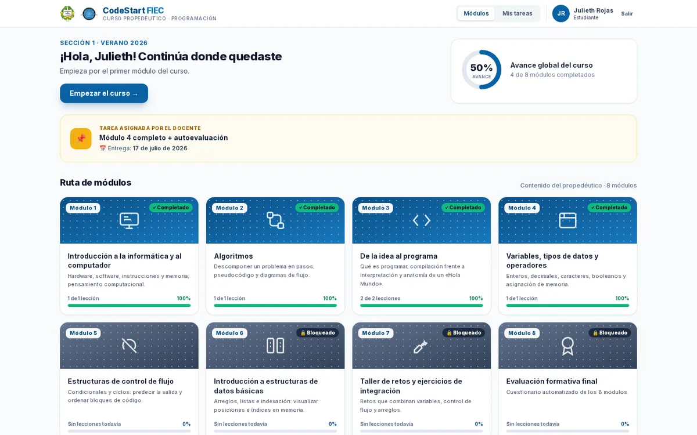
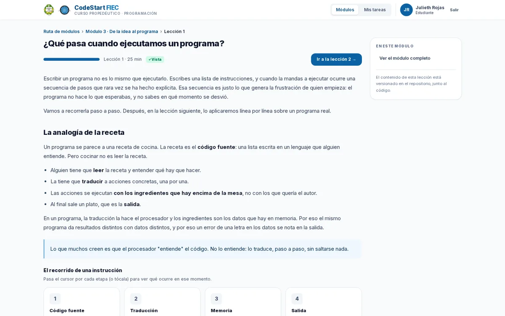

<div align="center">

<h1>CodeStart FIEC</h1>

<p><strong>Plataforma de apoyo al Curso Propedéutico · Versión beta</strong></p>

<p>Universidad de Panamá<br>
Facultad de Informática, Electrónica y Comunicación</p>

<p><em>Proyecto de la materia Informática Educativa · 2do Semestre 2026</em></p>

<p>
  <a href="https://codestart-fiec.vercel.app">
    
  </a>
  
  
  
  
  
</p>

</div>

<p align="center">
  <a href="https://codestart-fiec.vercel.app">
    
  </a>
</p>

> **¿Qué es este repositorio?**
>
> La **aplicación real** de CodeStart FIEC: ocho módulos con lecciones interactivas, retos de C con
> validación estática, evaluaciones, medallas y panel de seguimiento para el docente, construida con
> Next.js y Supabase. Esta es la **versión beta** (`v0.2.0-beta`).
>
> El **prototipo de diseño** vive aparte, en
> **[`Zobercito/codestart-fiec-mockup`](https://github.com/Zobercito/codestart-fiec-mockup)** ·
> demo: <https://zobercito.github.io/codestart-fiec-mockup/>.
>
> Proyecto de la materia **Informática Educativa** (2do Semestre 2026), Facultad de
> Informática, Electrónica y Comunicación, Universidad de Panamá.

---

## Qué puedes hacer hoy

| Área | Qué funciona |
|---|---|
| **Acceso** | Inicio de sesión con cuentas institucionales asignadas por el docente, inscripción con código de grupo y tres roles: estudiante, docente y administrador |
| **Estudiante** | Dashboard con avance, ruta de 8 módulos, tarea asignada y medallas; navegación por módulos y lecciones |
| **Lecciones** | Contenido en MDX con componentes interactivos: anatomía del código, simulador de memoria y recorrido de una instrucción |
| **Retos** | Editor CodeMirror con autoguardado, casos de prueba, pistas progresivas y diagnóstico del error |
| **Validación** | Analizador estático de C en el servidor: no ejecuta el código del estudiante, lo analiza y explica por qué falla |
| **Evaluaciones** | Autoevaluación por módulo y evaluación final con umbral de aprobación y áreas a reforzar |
| **Docente** | Panorama del grupo, detalle por estudiante, tarea asignada y patrón de error dominante, solo de sus propios grupos |
| **Modo clase** | Retos sin puntaje para resolver en grupo durante la sesión |

---

## Estado

| | |
|---|---|
| **Versión** | Beta `v0.2.0-beta` |
| **Base de datos** | 11 tablas con políticas de RLS por rol y por grupo |
| **Contenido** | Ocho módulos en MDX, del primero al taller de retos y la evaluación final |
| **Pruebas** | 33 unitarias (Vitest), suite E2E en escritorio, tableta y Firefox, matriz de RLS y pruebas de contraste |
| **Accesibilidad** | Contraste WCAG 2.1 AA verificado en 7 rutas: 0 fallos; revisión manual pendiente |
| **Rendimiento** | Con red limitada (Fast 3G, CPU 4×): LCP de 1,1–1,3 s. Con 100 usuarios concurrentes **no cumple RNF08**; el detalle está en `docs/INFORME_PRUEBAS.md` |
| **Pendiente para la 1.0** | Validación con estudiantes (RNF04), WebKit y Edge, y correcciones de la validación |

---

## Demo

**Aplicación:** <https://codestart-fiec.vercel.app>

| Correo | Rol |
|---|---|
| `docente@up.ac.pa` | docente |
| `francisco.gonzalez@up.ac.pa` | estudiante |

**Contraseña:** `Codestart2026!`

No hay registro público. Estas cuentas simulan las cuentas institucionales que el docente crea
para el curso; los estudiantes solo inician sesión con la que se les asigna.

El grupo de demostración es **Sección 1 · Verano 2026** y su código de inscripción es
`FIEC-V26-8QK4`. El script de cuentas inscribe automáticamente a cada estudiante en ese grupo,
de modo que su avance e intentos aparecen en el panel del docente; el código sigue disponible
para inscripciones manuales. Los datos son de prueba: no escribas información personal real.

---

## Arranque local

Requisitos: **Node.js 20+** y **npm 11+**. El `.npmrc` del repo autoriza los scripts de
instalación que npm 11 exige.

```bash
git clone https://github.com/Zobercito/codestart_fiec.git
cd codestart_fiec
npm install
cp .env.example .env.local   # completa las variables
npm run dev                  # http://localhost:3000
```

| Variable | Para qué |
|---|---|
| `NEXT_PUBLIC_SUPABASE_URL` | URL del proyecto de Supabase |
| `NEXT_PUBLIC_SUPABASE_ANON_KEY` | Clave anónima, la que usa el navegador |
| `SUPABASE_SERVICE_ROLE_KEY` | **Solo servidor.** Migraciones, seed y scripts. Nunca con prefijo `NEXT_PUBLIC_` |
| `SUPABASE_DB_PASSWORD` | Contraseña de la base de datos para la CLI |

Antes de commitear:

```bash
npm run typecheck && npm run lint && npm run build
```

---

## Base de datos

El proyecto de Supabase ya está creado y vinculado. Todo el flujo va por el **pooler**: el host
directo no resuelve por IPv6.

```bash
npm run db:migrate    # aplica supabase/migrations/
npm run db:usuarios   # crea los usuarios de prueba y sus perfiles
npm run db:seed       # carga grupo, módulos, lecciones, retos e intentos
npm run db:types      # regenera src/lib/supabase/types.generados.ts
```

---

## Cómo está construido

```text
src/
├── app/            rutas (App Router): públicas, de sesión y API
├── components/     ui · leccion · retos · docente
├── lib/            supabase (DAL) · auth (roles) · validacion (analizador de C)
└── content/        módulos y lecciones en MDX + retos en JSON
supabase/
├── migrations/     esquema, RLS y privilegios versionados
└── seed.sql        datos de demostración
tests/              pruebas E2E con Playwright
docs/               arquitectura, modelo de datos y decisiones
```

- **Rutas públicas:** `/`, `/login`, `/privacidad`.
- **Rutas de sesión:** `/dashboard`, `/modulos`, `/modulos/[m]`, `/modulos/[m]/lecciones/[l]`,
  `/retos/[id]`, `/evaluacion/[modulo]`, `/evaluacion/final`, `/medallas`.
- **Rutas del docente:** `/docente`, `/docente/grupo/[id]`, `/docente/estudiante/[id]`,
  `/docente/grupos`, `/docente/asignar`.
- **Seguridad:** la sesión se resuelve en el servidor y el rol se comprueba en el proxy, en la
  capa de datos y en el RLS de Postgres. Un estudiante no entra a `/docente` ni escribiendo la URL.

---

## El motor de validación

Los retos de código se validan **analizando** el programa, no ejecutándolo: C no se puede ejecutar
en el navegador, y además el análisis dice **por qué** falla, no solo que falla.

```text
fuente → tokens → parser → AST → tabla de símbolos con tipos → reglas del reto → diagnóstico
```

Las reglas de cada reto viven en la base de datos (JSONB) y describen **lo que el programa tiene
que hacer**, no cómo escribirlo. El mismo motor corre en el navegador (Web Worker) y en el
servidor; la verificación que cuenta es la del servidor, para que no se pueda falsificar.

Ejemplo del diagnóstico que ve el estudiante:

```text
La comparación con «edad» usa el operador «>», y el reto pide «>=».
Con 18, tu condición `edad > 18` es falsa, y respondió «Menor de edad».
El caso espera «Mayor de edad».
```

```bash
npm test        # 13 pruebas del motor
```

---

## Contenido de las lecciones

Las lecciones son archivos **MDX versionados en el repositorio** (`src/content/`), no filas de una
tabla. Editar una lección es un commit, con su revisión.

<p align="center">
  
</p>

| Componente | Qué hace |
|---|---|
| `<VisorAnatomia>` | Explica cada línea del programa al pasar el cursor, al enfocarla o al tocarla |
| `<SimuladorMemoria>` | Muestra la memoria como casilleros y cómo cambia instrucción a instrucción |
| `<RecorridoInstruccion>` | Sigue las cuatro etapas: fuente, traducción, memoria y salida |
| `<BloqueCodigo>` | Bloque de código con su etiqueta de lenguaje |

---

## Despliegue

La versión alfa está en Vercel con el proyecto ya vinculado y las variables configuradas:

```bash
vercel login
vercel --prod
```

Tras cada despliegue, comprueba `/login` y una lección con una cuenta de prueba. Si el proyecto se
recrea desde cero, ejecuta `vercel link` antes de `vercel --prod`.

---

## Documentación

- **[Arquitectura](docs/ARQUITECTURA.md)** — capas, decisiones de diseño y flujo de datos.
- **[Modelo de datos](docs/MODELO_DATOS.md)** — las 11 tablas, relaciones y políticas de RLS.
- **[Decisiones técnicas](docs/DECISIONES.md)** — ADR, incluida la validación estática de C.

## Repositorio del prototipo

El diseño de la interfaz —pantallas, tokens de color, storyboard y mapa de navegación— está en
**[`Zobercito/codestart-fiec-mockup`](https://github.com/Zobercito/codestart-fiec-mockup)** ·
demo: <https://zobercito.github.io/codestart-fiec-mockup/>.

---

<div align="center">

**Informática Educativa · 2do Semestre 2026 · Prof. Alvin Blanco**

Francisco Gonzalez · Eira Arrocha · Yasari Ortiz · Domingo de León

Universidad de Panamá · Facultad de Informática, Electrónica y Comunicación

</div>
